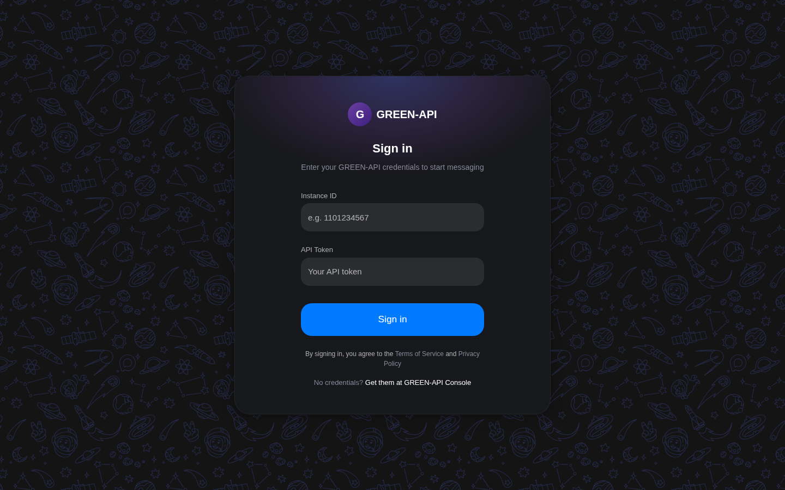
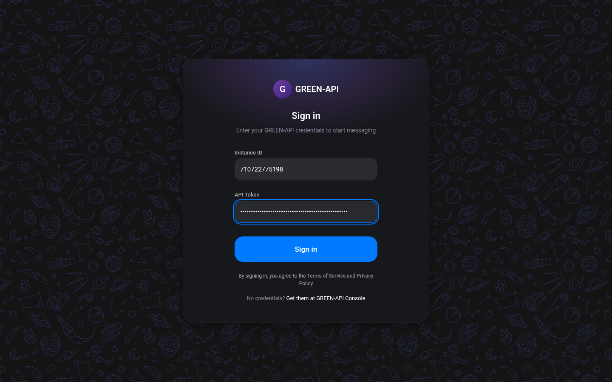
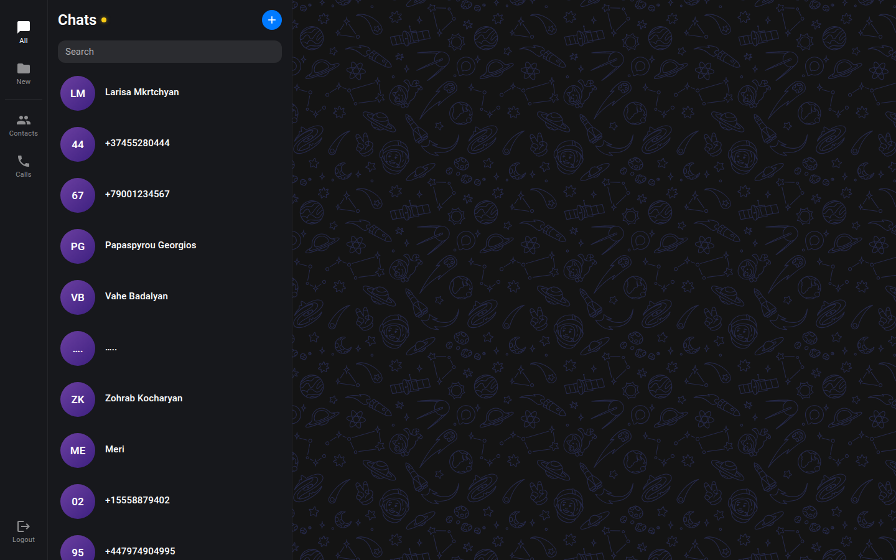
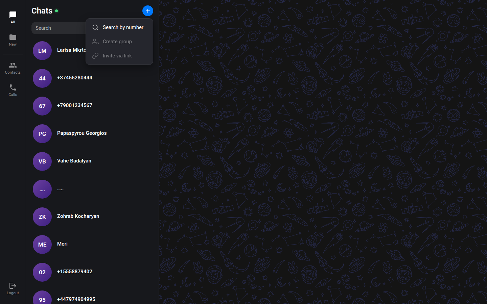
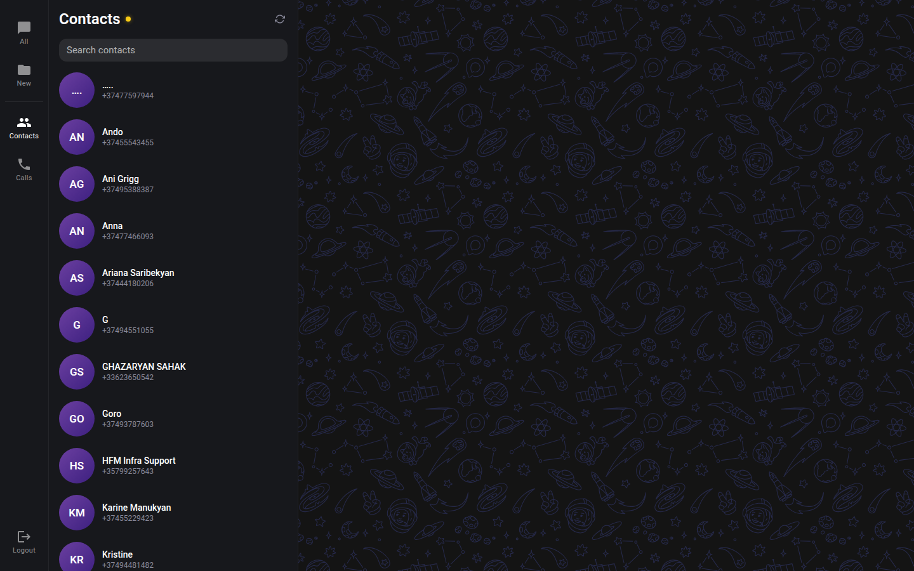
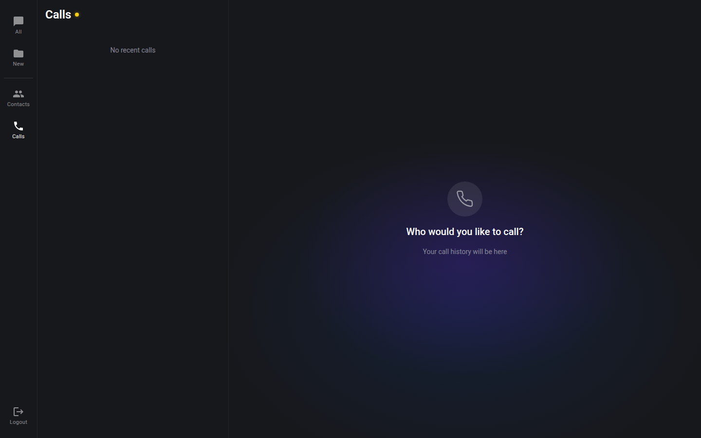
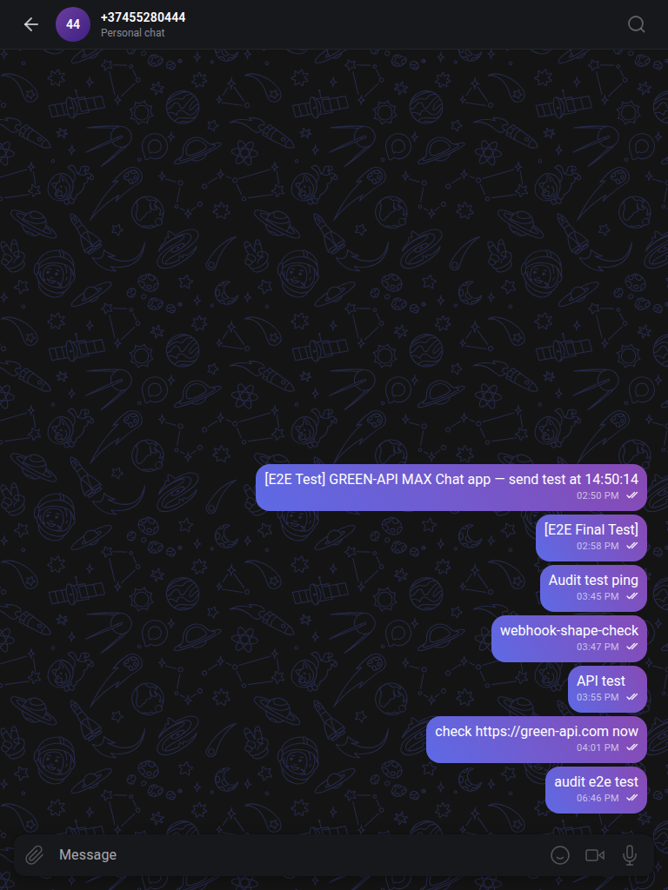
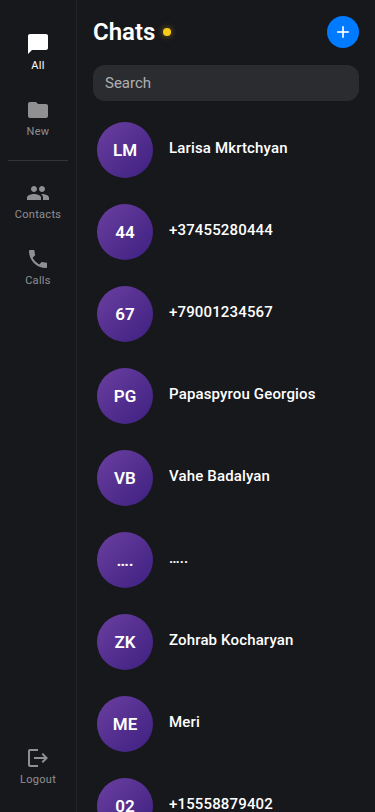

# GREEN-API MAX Chat

A React-based chat application for sending and receiving messages via MAX messenger using the GREEN-API service. The UI design matches [web.max.ru](https://web.max.ru/) — the official MAX web client.

> **Note on the API:** This app targets the GREEN-API service. MAX instances share the same HTTP API surface as GREEN-API's WhatsApp instances (same method names and `chatId` format), so some internal function names and API paths reference WhatsApp conventions. All user-facing functionality is MAX messaging.


## Screenshots

### Desktop

| Login                                              | Login (filled)                                           |
| -------------------------------------------------- | -------------------------------------------------------- |
|  |  |

| Chat Page                                          | New Chat Menu                                              |
| -------------------------------------------------- | ---------------------------------------------------------- |
|  |  |

| Contacts                                               | Calls                                           |
| ------------------------------------------------------ | ----------------------------------------------- |
|  |  |

### Tablet & Mobile

| Tablet                                         | Mobile                                         |
| ---------------------------------------------- | ---------------------------------------------- |
|  |  |

## Features

- 🔐 Secure authentication with GREEN-API credentials
- 💬 Send and receive text messages in real-time
- 📱 Responsive design (desktop two-pane, mobile single-pane)
- 💾 Persistent chat history (localStorage)
- 🔄 Real-time message polling with HTTP API
- 🎨 MAX-style dark theme matching web.max.ru
- ✅ Message delivery status (sent → delivered → read)
- 👥 Contacts list with search
- 📞 Call history view

## Tech Stack

| Technology | Purpose                      |
| ---------- | ---------------------------- |
| React 19   | UI library                   |
| Vite 8     | Build tool & dev server      |
| SCSS       | Styling (variables, BEM)     |
| Axios      | HTTP client with retry logic |
| GREEN-API  | MAX messaging service        |

## Getting Started

### Prerequisites

- **Node.js 18+** installed ([download](https://nodejs.org/))
- **GREEN-API account** with MAX instance credentials ([sign up](https://green-api.com/))

### Installation

```bash
# Clone the repository
git clone https://github.com/AvetBadalyan/Green-api.git
cd Green-api

# Install dependencies
npm install

# Start development server
npm run dev
```

Open [http://localhost:5173](http://localhost:5173) in your browser.

### Build for Production

```bash
npm run build
npm run preview  # Preview the production build locally
```

The production build will be in the `dist/` folder.

### Getting GREEN-API Credentials

1. Go to [GREEN-API Console](https://console.green-api.com/)
2. Create a new **MAX** instance (not WhatsApp)
3. Copy your `idInstance` and `apiTokenInstance`
4. Use these credentials to log in to the app

## Usage

1. **Login** — Enter your GREEN-API credentials (idInstance and apiTokenInstance)
2. **Start a chat** — Click the `+` button, select "Search by number"
3. **Enter phone number** — Use international format with country code (e.g., `79001234567`)
4. **Send messages** — Type in the input field and press Enter or click Send
5. **Receive replies** — Messages appear in real-time via polling

### Phone Number Format

Enter phone numbers **without** the `+` symbol:

- ✅ `79001234567` (Russia)
- ✅ `37455123456` (Armenia)
- ❌ `+79001234567` (don't include +)

## Project Structure

```
src/
├── components/              # Reusable UI components
│   ├── ChatAvatar/          # User avatar with initials/gradient
│   ├── ChatBackground/      # Decorative SVG background pattern
│   ├── ChatWindow/          # Main chat interface + input bar
│   ├── ConnectionStatus/    # API connection indicator
│   ├── ContactsPanel/       # Contacts view
│   ├── ErrorBoundary/       # Error boundary for lazy loading
│   ├── LoadingScreen/       # Loading spinner for Suspense
│   ├── MessageList/         # Scrollable message bubbles
│   ├── NewChatMenu/         # Dropdown menu for new chat
│   ├── NewChatModal/        # Phone number input modal
│   ├── Sidebar/             # Left sidebar (nav + chat list)
│   └── SidePanel/           # Shared panel shell component
├── context/                 # React Context providers
│   ├── AuthContext.jsx      # Authentication state & credentials
│   └── ChatContext.jsx      # Chats, messages, active chat state
├── hooks/                   # Custom React hooks
│   ├── useConnectionStatus.js  # API health check polling
│   └── useMessagePolling.js    # Incoming message polling
├── icons/                   # SVG icon components (20 icons)
├── pages/                   # Page-level components
│   ├── CallsPage/           # Calls view
│   ├── ChatPage/            # Main chat layout
│   └── LoginPage/           # Login form
├── services/                # External API integration
│   ├── api.js               # GREEN-API wrapper functions
│   └── avatarCache.js       # Avatar caching with rate limiting
├── styles/                  # Global styles & variables
│   ├── global.scss          # CSS reset & base styles
│   └── variables.scss       # SCSS design tokens
├── constants.js             # App-wide configuration constants
├── App.jsx                  # Root component with providers
├── AppRouter.jsx            # Route definitions with ErrorBoundary
└── main.jsx                 # Entry point
```

## API Integration

This app uses the [GREEN-API HTTP API](https://green-api.com/docs/api/) for MAX:

| Endpoint              | Purpose                             |
| --------------------- | ----------------------------------- |
| `SendMessage`         | Send text messages                  |
| `ReceiveNotification` | Long-poll for incoming events       |
| `DeleteNotification`  | Acknowledge processed notifications |
| `GetStateInstance`    | Check connection status             |
| `GetChats`            | Fetch existing chat list            |
| `GetChatHistory`      | Load message history for a chat     |
| `ReadChat`            | Mark messages as read               |
| `SendTyping`          | Send typing indicator               |
| `GetContacts`         | Fetch contact list                  |
| `CheckWhatsapp`       | Verify phone number exists          |

## Scripts

| Command           | Description              |
| ----------------- | ------------------------ |
| `npm run dev`     | Start development server |
| `npm run build`   | Build for production     |
| `npm run preview` | Preview production build |
| `npm run lint`    | Run oxlint               |

## Browser Support

- Chrome 90+
- Firefox 90+
- Safari 14+
- Edge 90+

## Known Limitations

- **Text messages only** — attachments, images, and voice messages are not supported (per task requirements)
- **No real-time WebSocket** — uses HTTP polling (GREEN-API limitation for MAX)
- **No end-to-end encryption** — messages are handled by GREEN-API servers

## Author

**Avet Badalyan**

- GitHub: [@AvetBadalyan](https://github.com/AvetBadalyan)
- Telegram: [@avetbadalyan](https://t.me/avetbadalyan)

---

_Created as a test assignment for GREEN-API — Frontend React Developer position_
